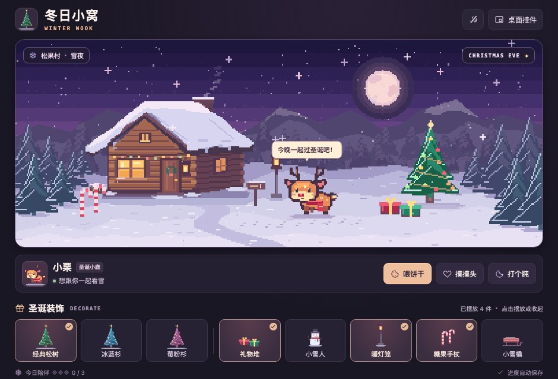

# 冬日小窝 · Winter Nook

一款离线运行的 macOS 像素宠物游戏。雪夜里的小鹿叫小栗。

[下载 18 秒 MP4 演示](https://github.com/gxglxhx2/winter-nook/raw/refs/heads/main/docs/media/winter-nook-demo.mp4)

[下载 Mac 版](https://github.com/gxglxhx2/winter-nook/releases/latest) · 发布者：Science Live

## 截图

**布置界面**

**桌面挂件**

## 开始玩

- 解压游戏包，双击「冬日小窝.app」。支持 macOS 12 或更新版本，包含 Apple 芯片和 Intel 版本。

## 功能与操作

| 功能 | 怎么玩 |
| --- | --- |
| 照顾小栗 | 点小鹿摸摸它，或按「喂饼干」「打个盹」。每天完成三种互动就能收齐三枚雪花。 |
| 装饰雪地 | 在经典松树、冰蓝杉和莓粉杉之间切换。礼物、雪人、暖灯笼、糖果手杖和雪橇都能单独摆放或收起。 |
| 桌面挂件 | 点右上角「桌面挂件」，让小鹿和圣诞树置顶显示在 Dock 上方。鼠标移到挂件右侧可操作，按 **⌥⌘M** 回到布置界面。 |
| 音乐和存档 | 点音符开关音乐；装饰和陪伴进度会自动保存在这台 Mac 上，游戏可离线运行。 |

## 源码

- `web/art.js`：原始像素画、雪景、桌面挂件和动画。
- `web/game.js`：互动、装饰、存档和本地合成的音乐。
- `main.m`：macOS 窗口、底部置顶和本地进度存储。
- `make-icon.py`：小鹿与圣诞树的应用图标绘制。图标已生成，无需重新绘制即可构建。

安装好 Apple Command Line Tools 后，在此目录执行 `bash build.sh`。生成的 App 位于 `build/冬日小窝.app`。也可执行 `bash build.sh "/其他目录/冬日小窝.app"` 指定一个新路径。浏览器打开 `web/index.html` 可预览游戏；桌面置顶由 macOS App 提供。
