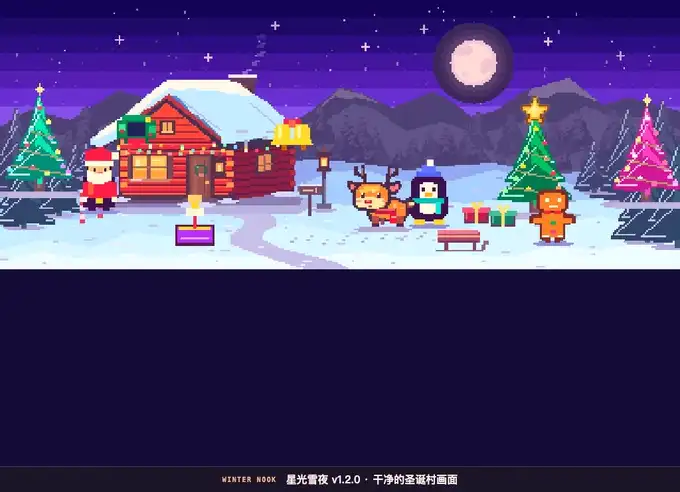
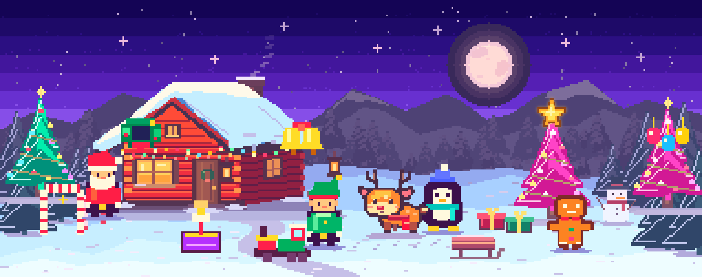

# 冬日小窝 · 星光雪夜

Science Live 制作的 macOS 像素宠物游戏。让小鹿小栗、亮着彩灯的圣诞树和音乐盒留在屏幕底部。

**[下载最新 Mac 版](https://github.com/gxglxhx2/winter-nook/releases/latest)**。解压后打开「冬日小窝-圣诞音乐盒.app」，支持 macOS 12 及以上、Apple 芯片与 Intel Mac。

## 演示

[下载 19 秒带音乐的演示 MP4](https://github.com/gxglxhx2/winter-nook/raw/refs/tags/v1.2.0/docs/media/v1.2.0/star-snow-demo.mp4)

## 游戏截图

## 功能与操作

| 功能 | 怎么玩 |
| --- | --- |
| 树顶星星 | 点金色像素星打开设置。星星短暂放大后变成齿轮，再点一次或按 Esc 收起。 |
| 桌面雪花 | 在设置中打开「桌面挂件」。上方有一层透明飘雪，开始播放音乐时会落下 11 秒彩色星雪。 |
| 圣诞音乐盒 | 选播 13 首曲目，调音量、切歌或单曲循环。点「＋本地歌曲」可在当前会话导入 MP3、M4A、WAV 等。 |
| DIY 圣诞村 | 用 6 款树填满三个树位，挑选 6 位像素伙伴和 15 件挂饰，切换红金、糖果或极光主题。 |
| 照顾小栗 | 摸摸小鹿、喂饼干、让它打盹，每天收集三枚雪花。旧版布置可以带入。 |

## 源码

在安装好 Apple Command Line Tools 的 Mac 上运行 `bash build.sh`。应用输出到 `build/冬日小窝.app`。浏览器也可以打开 `web/index.html` 预览游戏。

像素插画和音乐盒编曲均为本项目制作。配色和节日挂饰的灵感来自 [LEGO 2026 Holiday House](https://www.lego.com/en-ca/aboutus/news/2026/september/the-lego-group-builds-up-to-the-holidays)。
